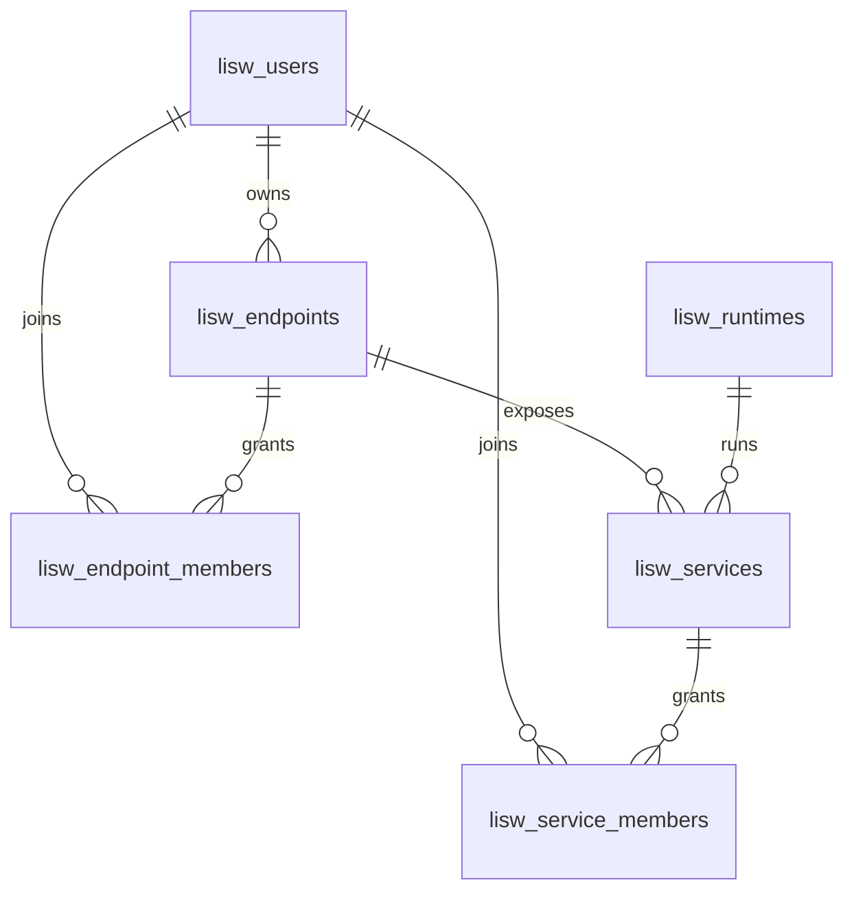

# 数据模型

以稳定 ID 建关联，IP/域名只是 Endpoint 的可变地址，不能作为用户权限的外键。当前单工作空间模型使用 lisw_ 前缀，避免影响同数据库的其他应用。

| 表 | 关键字段 | 约束 / 用途 |
| --- | --- | --- |
| lisw_users | id, username, display_name, github_username, email, password_hash, platform_role, status, is_demo | 用户名、GitHub 用户名、非空邮箱唯一；未设置的邮箱和密码为 NULL |
| lisw_endpoints | id, name, address, address_type, region, provider, owner_user_id | IPv4 / IPv6 / 域名；地址唯一，owner 外键限制删除 |
| lisw_runtimes | id, name, location, host_address | 实际运行机器，与入口独立，可为其他电脑或远程节点 |
| lisw_services | id, endpoint_id, runtime_id, kind, name, status, version, revision, config, control_mode | 入口与运行位置外键；kind 可扩展；config JSON；控制模式 mock/managed |
| lisw_endpoint_members | endpoint_id, user_id, role | 联合主键；入口管理员/用户 |
| lisw_service_members | service_id, user_id, role | 联合主键；服务管理员/用户 |
| lisw_panel_state | id, version, document | 兼容现有 API 的快照读模型和事件历史 |
| lisw_relational_sync | id, source_version | 关系表对应的快照版本，兼容升级前的进程写入 |

所有业务实体带创建/更新时间；服务保留既有 updatedAt 和 revision；成员表按用户索引以便查询授权资源。用户删除受外键保护，资源成员关系跟随资源删除。

## 初始化记录
- 用户 id=admin，username=snacking，display_name=Snacking，github_username=snacking，platform_role=admin，is_demo=false。沿用 admin ID 保持已有会话与授权兼容；邮箱未设置；密码已通过一次性数据库操作设置，不写入代码仓库。登录已启用数据库密码校验，公开注册暂未开放。
- Endpoint id=racknerd，地址 198.12.74.38，类型 ipv4，provider=RackNerd，region=美国 · 洛杉矶，owner_user_id=admin。
- Runtime id=vps，host_address=198.12.74.38，表示该 VPS 本机部署。
- hy2 / Hysteria 2 与 vless / VLESS · Reality 从现有快照迁移，保留当前配置、版本、revision、成员权限；仍为 mock 控制，未读取或写入真实服务密钥。
- 既有 friend 演示成员保留，is_demo=true；不将其视为新注册的真实用户。

## 写入和迁移
DDL 独立存放于 backend/database/sql/002–008，参数化 DML 单独存放在同目录。部署时执行版本迁移（不包含个人账号初始化），首次 Load 在事务中锁住 workspace 快照行后回填关系表。之后 Save 的版本 CAS、关系表更新和同步版本标记在同一个事务提交；失败全部回滚。旧版本实例只更新快照时，新实例按 source_version 检测并补齐，避免滚动部署时漏数据。

API 暂时继续通过快照读模型工作，因此直接手动修改关系表不会自动反馈到 API；应通过应用写入以保持两者一致。用户资料不随快照覆盖或删除。当前没有实现用户管理/成员管理写 API，后续可在同一事务中扩展，不应维护两套独立数据源。

检查：go test ./database；显式执行线上集成检查：LISW_DB_INTEGRATION=1 DATABASE_CONFIG_FILE=~/.config/lisw-panel/database.json go test ./database -run TestLiveRelationalMigration -v。

正常保存按上一版本计算差异：只更新变动实体和成员关系，批量插入同类记录；删除仅在确实移除资源时执行。首次回填仍执行完整同步。远程 MySQL 实际 API 保存验证约 3.5 秒，事务失败回滚和原配置保留均已检查。

## DDL / DML 与发布规则（更新）
DDL 仅在 backend/database/sql/ddl，运行时参数化 DML 仅在 sql/dml；个人账号初始化 SQL 已移除。使用 panel --migrate 执行尚未登记的 DDL，普通进程只 CheckSchema，不能建表。
迁移使用独立连接上的 GET_LOCK 序列化，并在 lisw_schema_migrations 记录文件名、SHA256、执行时间；已有版本直接跳过，历史文件校验和不一致则阻止部署。历史表首次接管登记 adopted=true，不重放建表语句。MySQL DDL 会自动提交，每文件只允许单条建表语句，未来结构变更应新增受控版本迁移，不修改历史文件。
部署先解包新二进制，再显式迁移，成功后才切换 current 和重启。数据库结构不跟随二进制回滚，迁移需对旧版本向后兼容；破坏性变更应分阶段执行。本机开发脚本同样显式迁移。
CI 使用一次性 MySQL 8 验证新库建表、并发迁移、重复执行、校验和异常阻断、DDL 不创建用户。个人账号通过一次性操作设置，password_hash 保存带随机盐的 PBKDF2-SHA256 哈希，600000 次迭代，不存明文。账号初始化操作不提交仓库，登录已启用数据库密码校验，旧演示会话失效。
